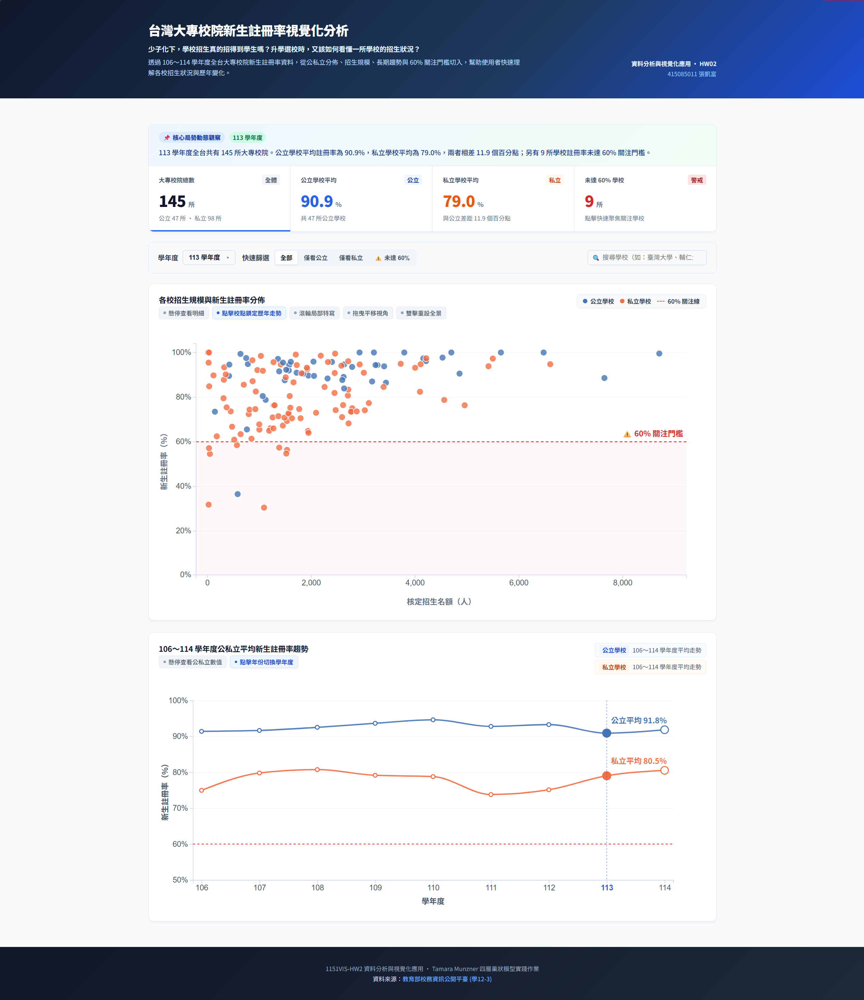

# 📝 HW02 作業說明

- **課程名稱**：資料分析與視覺化應用
- **學號姓名**：415085011 張凱富
- **GitHub Repository**：[台灣大專校院新生註冊率視覺化分析](https://github.com/powerkaifu/1151VIS-HW2-415085011-CHANG-KAI-FU)
- **作業網址**：[台灣大專校院新生註冊率視覺化分析](https://powerkaifu.github.io/1151VIS-HW2-415085011-CHANG-KAI-FU/)
- **影片網址**：[視覺互動展示影片](https://youtu.be/Wb4iHk4teng)
- **資料來源**：[教育部大專校院校務資訊公開平臺](https://udb.moe.edu.tw/udata/DetailReportList/%E5%AD%B8%E7%94%9F%E9%A1%9E)

## 📸 專案執行成果展示

## 🛠️ 開發環境與技術棧

| 項目           | 版本／說明                                                      |
| :------------- | :-------------------------------------------------------------- |
| 建置工具       | Vite 6.x                                                        |
| 核心框架       | Vue 3（Composition API / `<script setup>`）                     |
| 視覺化函式庫   | D3.js v7.x                                                      |
| 視覺化理論架構 | Tamara Munzner《Visualization Analysis and Design》四層巢狀模型 |

---

## 📖 Tamara Munzner 四層巢狀模型分析（重點摘要）

### 🏛️ Level 1：領域情境（Domain Situation）

- **核心課題**：少子化海嘯下，全台大專校院招生規模與新生註冊率現況為何？公私立學校是否有結構性差距？哪些學校落在 60% 關注門檻之下？
- **目標族群**：升學選校學生與家長、高教政策研究人員、教育行政主管。
- **資料來源**：教育部校務資訊公開平臺（學12-3，106～114 學年度全量共 1,382 筆記錄）。

---

### 📊 Level 2：What / Why —— 資料與任務抽象化（Data & Task）

#### What —— 資料屬性定性

- **資料集型態**：Table（多屬性表格）＋ Temporal Time Series（106～114 學年度時間序列）
- **主要欄位與屬性定性**：
  - `學年度`：Ordered / Temporal Key（106～114 學年度）
  - `設立別`：Categorical Key（公立 / 私立）
  - `學校名稱`：Categorical Key（各校名稱識別）
  - `核定招生名額`：Quantitative（招生規模量體，X 軸通道，0 ～ 7,000+ 人）
  - `新生註冊率`：Quantitative（核心量化指標，Y 軸通道，0% ～ 100%）
  - `衍生指標`：公私立差距（Gap）、未達 60% 關注群體標記。

#### Why —— 抽象任務三元組 {Action, Target}

|     #      | 領域問題                                | Action（行動） |   Target（目標）    | 抽象任務說明                                 |
| :--------: | :-------------------------------------- | :------------: | :-----------------: | :------------------------------------------- |
| **Task 1** | 公私立在規模與註冊率上的分佈特徵？      |  **Compare**   |  **Distribution**   | 比較公私立兩群體在雙維度空間中的集群分佈     |
| **Task 2** | 哪些學校的新生註冊率落在 60% 門檻以下？ |  **Identify**  | **Outliers (<60%)** | 識別並定位低於 60% 關注線的學校              |
| **Task 3** | 106～114 年公私立平均註冊率的長期走勢？ |  **Discover**  |     **Trends**      | 探索 9 年時間序列上公私立平均線的變化走勢    |
| **Task 4** | 特定關注學校的 9 年歷程走勢如何？       |   **Lookup**   |    **Features**     | 檢索特定學校並比對其與公私立基準線的相對走勢 |

---

### 🎨 Level 3：How —— 視覺編碼與互動設計（Visual & Interaction Idiom）

#### 1. 視覺編碼（Encode）

- **主圖：散佈圖（Scatter Plot — 當年全景）**
  - **空間位置**：X 軸＝核定招生名額、Y 軸＝新生註冊率（最有效的定量位置通道）。
  - **色相編碼**：公立＝深藍（`#4575b4`）、私立＝暖橘（`#f46d43`）。
  - **參考標記**：Y = 60% 紅色虛線與淡紅關注帶。
- **副圖：折線圖（Trend Line — 9 年歷史走勢）**
  - **空間位置**：X 軸＝學年度、Y 軸＝新生註冊率。
  - **曲線編碼**：公立均線（藍色）、私立均線（橘色）、鎖定學校歷年軌跡（紫色加粗線 `#7c3aed`）。

#### 2. 多視圖協同（Facet & Coordinate）

- **垂直並置（Juxtapose）**：散佈圖（截面分佈）與折線圖（時間走勢）上下縱向串接。
- **雙向深度聯動（Linked Highlighting & Selection）**：
  - **散佈圖 ➔ 折線圖**：點擊特定校圓點，折線圖立即疊加該校 9 年走勢曲線。
  - **折線圖 ➔ 散佈圖**：點擊折線圖任意年份，全站（散佈圖、KPI、導讀）立即切換至該年度。

#### 3. 互動探索（Manipulate & Reduce）

- **直接操作縮放與平移**：滑鼠滾輪游標焦點連續縮放（Zoom）、按住左鍵流暢平移（Pan）、雙擊或按鈕一鍵還原全景（Reset）。
- **條件過濾（Filter）**：頂部 KPI 指標卡與膠囊按鈕（全部 / 公立 / 私立 / 未達 60%）即時篩選。
- **搜尋檢索（Search & Autocomplete）**：校名即時關鍵字搜尋與候選下拉浮層。
- **雙向導航（Scroll Toast）**：鎖定學校後，底部懸浮卡依視窗位置智慧切換前往走勢圖或返回散佈圖。

---

### ⚙️ Level 4：演算法與工程實作（Implementation）

- **資料綁定與補間動畫**：使用 D3 Object Constancy（以學校為 Key），學年度切換時呈現 750ms 平滑位置補間動畫。
- **邊界保護機制**：SVG clipPath 裁切防溢出、右側 60px 安全邊界避免 114 年標籤文字截斷。
- **數值規範**：全站註冊率格式統一四捨五入至小數第 1 位（`toFixed(1)%`）。

---

## 📌 主要互動功能與測試速查指南

本專案提供豐富的雙向聯動與現代互動體驗，您可以依照下方清單進行功能測試與驗證：

| 測試區域            | 核心互動功能            | 操作與測試方式                                             | 預期視覺反饋                                                                                                            |
| :------------------ | :---------------------- | :--------------------------------------------------------- | :---------------------------------------------------------------------------------------------------------------------- |
| **頂部 KPI 指標艙** | **指標聯動點擊篩選**    | 點擊任一 KPI 卡片（如「公立學校平均」、「未達 60% 學校」） | 立即觸發快速篩選，非該群體圓點淡出，下方散佈圖同步聚焦                                                                  |
| **綜合控制列**      | **學年度切換動畫**      | 切換左側「學年度」下拉選單                                 | 所有圓點以 750ms 平滑補間滑動至新學年度的名額與註冊率座標                                                               |
| **綜合控制列**      | **快速條件篩選**        | 點擊膠囊按鈕「全部 / 僅看公立 / 僅看私立 / ⚠️ 未達 60%」   | 各群體圓點平滑淡入淡出，KPI 卡片同步亮起對應底線                                                                        |
| **綜合控制列**      | **即時搜尋候選下拉**    | 搜尋框輸入關鍵字（如輸入「輔仁」或「科技」）               | 自動浮出即時候選列表，點擊任一項目直接精確鎖定該校                                                                      |
| **主圖：散佈圖**    | **滑鼠滾輪縮放**        | 未鎖定學校時，於畫布內滾動滑鼠滾輪（向上放大 / 向下縮小）  | 以滑鼠游標為中心向四周連續平滑縮放聚焦，100% 滿分校圓點不裁切                                                           |
| **主圖：散佈圖**    | **按住拖曳平移**        | 放大視野後，在畫布任意處按住滑鼠左鍵拖曳                   | 維持標準滑鼠游標，流暢平移瀏覽不同名額與註冊率區間                                                                      |
| **主圖：散佈圖**    | **雙擊 / 一鍵還原全景** | 雙擊畫布空白處，或點擊右上角出現的「⟲ 重設全景」按鈕       | 750ms 平滑過渡回到 0～104% 呼吸全景視野                                                                                 |
| **主圖：散佈圖**    | **點選鎖定／再點解除**  | 單擊任一學校圓點鎖定；**再次點擊同一校解除鎖定**           | 點選後下方折線圖繪製專屬 9 年歷年走勢；再點一次還原全景                                                                 |
| **主圖：散佈圖**    | **點擊空白取消鎖定**    | 於散佈圖空白處單擊一下                                     | 立即解除選校鎖定，散佈圖與折線圖同步還原為全校基準                                                                      |
| **主圖：散佈圖**    | **鎖定時滾輪自動捲動**  | 鎖定特定學校後，在畫布上滾動滾輪                           | 滾輪自動轉為捲動網頁視窗，便於順暢向下瀏覽對照折線圖                                                                    |
| **副圖：折線圖**    | **懸停吸附十字線**      | 滑鼠在折線圖上方左右滑動                                   | 垂直虛線自動吸附最近年份，高亮公私立圓點並顯示深色毛玻璃 Tooltip                                                        |
| **副圖：折線圖**    | **點擊年份雙向穿梭**    | 點擊折線圖上的任意年份節點或 X 軸「學年度」刻度數字        | 全站（散佈圖、頂部 KPI、新聞導讀）立即切換至該學年度                                                                    |
| **副圖：折線圖**    | **右上角重設鎖定**      | 鎖定學校時，點擊折線圖右上角的「✕ 重設鎖定」按鈕           | 解除鎖定狀態，折線圖移除該校專屬曲線                                                                                    |
| **底部浮動引導卡**  | **雙向滾動感知導航**    | 鎖定學校後，觀察畫面底部出現的毛玻璃引導卡（Toast）        | 位於上方時點擊「👇 前往歷年走勢」平滑滾動至折線圖；滑到下方時自動變為「👆 返回散佈圖」支援快速回頂部，亦可點擊「✕」解除 |
